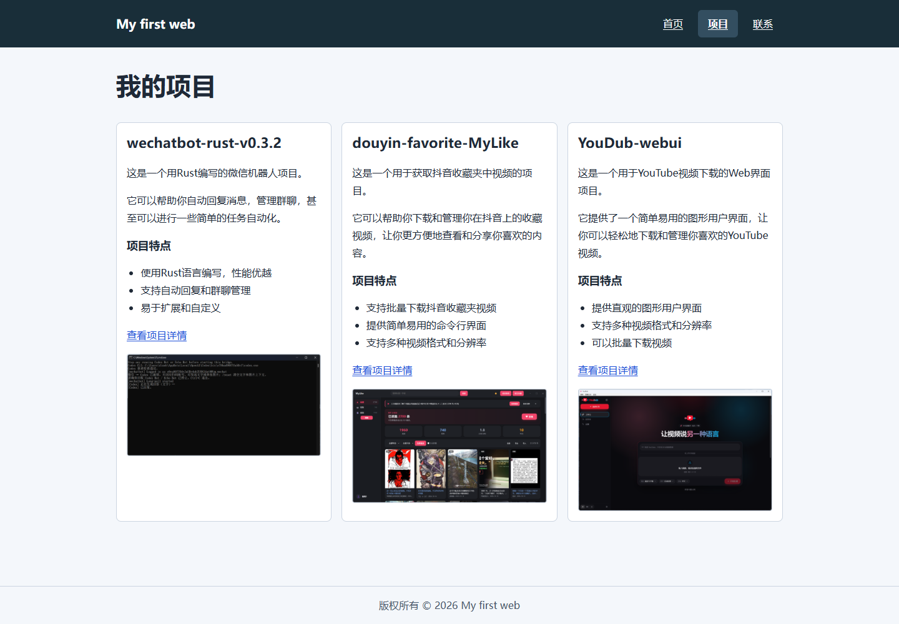
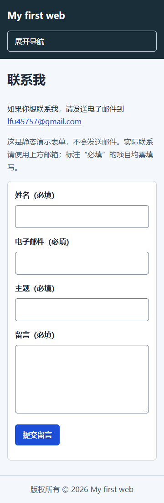

# My HTML Site

我的第一个 HTML 学习网站，用来记录从页面结构到网站部署的学习过程。

## 当前学习进度

截至 **2026-10-26**，阶段 3「CSS 与响应式布局」和阶段 4「最小 JavaScript 与质量检查」已完成本地验收。

- 四个页面共用样式和通过 `defer` 加载的脚本，保留 HTML、CSS、原生 JavaScript 的学习结构。
- 统一颜色、间距、字体和最大宽度；正文采用深色文字与浅色背景，页头采用高对比配色。
- 导航使用 Flexbox，项目卡片使用 Grid；不超过 `768px` 时改为单列并提供导航开关。
- 图片自适应容器，补齐实际尺寸以减少布局偏移，统一使用 `/` 路径，并延迟加载项目截图。
- 链接、按钮和输入框有清晰的键盘焦点；增加跳到正文入口、当前导航页标记，每页仅保留一个主要 `h1`。
- 移动导航同步 `aria-expanded`，支持鼠标、Enter、Tab、Escape；调整窗口宽度后同步状态并保留可用焦点。关闭 JavaScript 时导航链接仍可使用。
- 页脚自动显示当前年份。
- 联系表单补齐主题字段，使用姓名、邮箱、主题和留言的原生必填校验；脚本仅在校验通过后显示演示提示，不实际发送邮件。
- 页面标题和描述各自独立，增加本地 SVG 网站图标。

### 质量验收

四个页面在 `360px`、`768px`、`1440px` 下的 12 组检查均通过：没有横向滚动，文字、图片和表单正常显示。移动导航、键盘焦点、断点切换、原生表单校验与关闭 JavaScript 后的导航检查通过；页面未捕获脚本异常、控制台错误或请求失败。相对链接、样式、脚本、图片和三个项目外链均返回 HTTP 200。

移动端 Lighthouse 实测（本机 HTTP 服务，Lighthouse 13.5.0）：

| 页面 | Performance | Accessibility | Best Practices | SEO |
| --- | ---: | ---: | ---: | ---: |
| index.html | 100 | 100 | 100 | 100 |
| projects.html | 100 | 100 | 100 | 100 |
| contact.html | 100 | 100 | 100 | 100 |
| 404.html | 100 | 100 | 100 | 100 |

完整范围与限制见[阶段 3–4 验收记录](docs/阶段3-4验收记录.md)，自动检查结果见[浏览器检查记录](docs/checks/browser-checks.json)和[Lighthouse 分数记录](docs/checks/lighthouse-scores.json)。

### 实际页面预览





### 待完成内容与已知限制

- 本次质量分数来自本机移动端模拟，不代表上线后、真实手机或其他浏览器下的相同分数。
- 表单为静态演示，没有后端或发信服务；实际联系请使用页面中的邮件链接。
- `deploy/nginx.conf` 仍为空；Ubuntu/Nginx、域名、HTTPS、自动续期及回滚演练尚未完成，尚无已验收的公网地址。
- 项目截图保留原 PNG；后续如线上网络较慢，可生成更小的 WebP/AVIF 图片及多尺寸版本，并在正式服务器复测。

完整学习任务见 [HTML网站从零到服务器任务书](HTML网站从零到服务器任务书.md)。本次仅完成阶段 3、4，后续服务器步骤继续按任务书推进。

## 提交记录与学习里程碑

- 2026-10-26：完成阶段 3、4 的样式、响应式、移动导航与质量验收；补齐表单和页面语义，并记录四页面 Lighthouse 实测结果。
- 2026-10-18 · [`6354ac8`](https://github.com/lfu45757-star/my-html-site/commit/6354ac8a351e1e4cc6fbe23a1e405a35041d5d0b)：创建 HTML 页面、项目图片、学习任务书和目录骨架。
- 2026-10-18 · [`2bb7b83`](https://github.com/lfu45757-star/my-html-site/commit/2bb7b8350b8b4556a45d0808e08f867f9ebcf515)：补充当时的学习进度与 VS Code 手动提交、推送教程。
- 2026-10-19 · [`1e8e48d`](https://github.com/lfu45757-star/my-html-site/commit/1e8e48d4023d1e207350079f1dbc522fb5fbbe27)：引入公共 CSS，完成 Flexbox 导航、Grid 项目卡片和移动端断点；同时补充联系表单、404 页面及外链属性，并整理 Markdown 格式。

查看[完整提交历史](https://github.com/lfu45757-star/my-html-site/commits/main/)。

## 项目结构

```text
my-HTML-site/
├── index.html
├── projects.html
├── contact.html
├── 404.html
├── README.md
├── HTML网站从零到服务器任务书.md
├── assets/
│   ├── css/style.css
│   ├── js/main.js
│   └── images/
├── docs/
│   ├── 阶段3-4验收记录.md
│   ├── checks/
│   └── images/
└── deploy/nginx.conf
```

## 本地查看

使用 VS Code 打开项目文件夹，安装 Live Server 扩展后，右键 `index.html`，选择 **Open with Live Server**。

也可以直接用浏览器打开 `index.html` 查看当前静态页面。如果已安装 Python，可以在项目目录执行：

```powershell
python -m http.server 8080
```

然后访问 <http://localhost:8080>。当前没有构建步骤，也不需要安装 npm 依赖。

## 在 VS Code 中手动提交并推送

本项目远程仓库：<https://github.com/lfu45757-star/my-html-site>，分支为 `main`。

1. 在 VS Code 中打开本项目文件夹，修改代码后按 `Ctrl+S` 保存。
1. 按 `Ctrl+Shift+G` 打开“源代码管理”，点击文件检查本次差异。
1. 点击需要提交的文件旁的 `+`，把改动加入“暂存的更改”。如果全部文件都需要上传，可以点击“更改”标题旁的 `+`。
1. 在消息框中填写本次学习内容，例如 `feat: add homepage styles`，点击“提交（Commit）”。此时只是保存到了本地 Git。
1. 按 `Ctrl+Shift+P`，运行 `Git: Push`，把提交上传到 GitHub。也可从源代码管理的 `…` 菜单选择“推送（Push）”。
1. 刷新 GitHub 仓库页面，确认最新提交已出现。若提示登录，使用自己的 GitHub 账号完成浏览器授权。

“同步更改（Sync Changes）”会先拉取远程提交再推送本地提交。如果只想上传，选择“推送”。本项目首次推送完成后，后续不需要重新初始化仓库或重复添加 `origin`。

### VS Code 终端中的等价命令

在项目根目录打开终端，先检查改动，再执行：

```powershell
git status
git diff
git add .
git commit -m "feat: describe this learning update"
git push
```

`git add .` 会暂存当前目录下所有未忽略的改动，执行前先确认列表中都是准备上传的文件。没有改动时，无需再次提交。

如果提示远程有本地尚未获取的提交，先保存并提交本地改动，再执行 `git pull --rebase`，处理可能的冲突后执行 `git push`。

参考：[VS Code 提交说明](https://code.visualstudio.com/docs/sourcecontrol/staging-commits)、[远程仓库与推送](https://code.visualstudio.com/docs/sourcecontrol/repos-remotes)。
