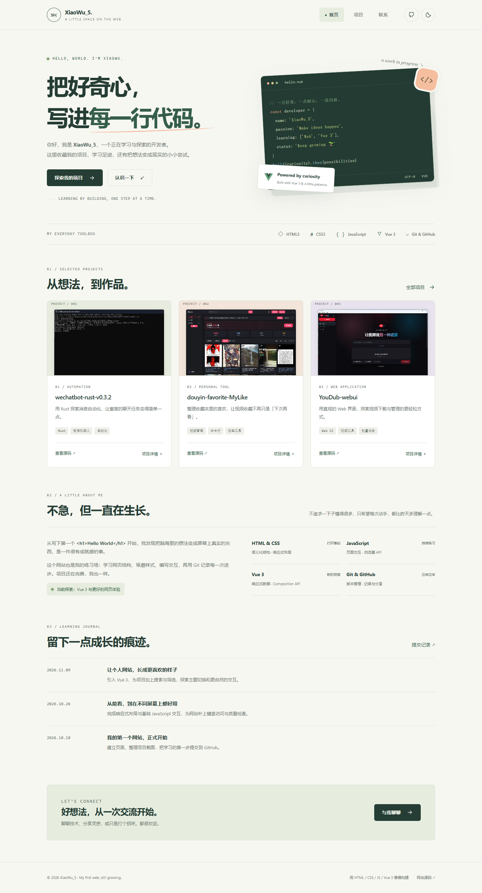

# XiaoWu_5 · My first web

一个用 **HTML + CSS + JavaScript + Vue 3.5.45** 构建的个人网站。记录学习，展示项目，也给好想法留一个小小的位置。



## 这次更新 · 2026-11-09

- 四页统一为米白 / 森林绿的视觉设计，保留原姓名、邮箱、三个项目、原始截图及页面路径。
- 首页增加个人介绍、技术工具栏、项目展示、学习时间线和联系入口。
- Vue 3 Composition API 驱动项目分类、名称 / 简介 / 标签搜索、空结果与重置。
- 项目详情使用原生 `<dialog>`：键盘焦点约束、Escape 关闭、焦点恢复与背景滚动锁定。
- 深浅主题跟随系统，手动选择保存到本地；存储被禁用时也能正常浏览。
- 移动导航支持 Escape、键盘操作、点击外部关闭以及跨断点焦点转移。
- 联系页支持原生校验、字数提示、邮件草稿预览、复制与 `mailto:`，**不会假装已发信**。
- 截图卡片使用 WebP，三个预览共约 107 KB，比原始 PNG 总大小减少约 94%；弹窗仍可查看原 PNG。
- 保留无 JavaScript / Vue 加载失败的后备内容；导航、项目介绍、源码和直接邮箱仍然可用。
- 没有访客追踪、外部字体或运行时 CDN 请求；表单信息不写入本地存储、不提交服务器。

## 为什么采用这种结构

遵循 [Vue 官方文档的免构建使用方式](https://vuejs.org/guide/quick-start.html#using-vue-from-cdn)，但把固定版本的生产运行库保存在 `assets/vendor/`，不依赖访客访问 CDN。

**HTML 是内容源，CSS 负责布局，Vue 负责渐进增强交互。** 不引入路由器或后端，不改变 `index.html`、`projects.html`、`contact.html`、`404.html` 四个地址。用 Live Server 或任意静态 HTTP 服务即可查看，不需要先构建。

## 本地运行

直接用 VS Code Live Server 打开 `index.html`；或者使用 Node.js 22+：

```powershell
npm ci
npm run dev
```

访问终端输出的本机地址，默认 `http://127.0.0.1:4173`。预览服务只监听本机，只提供网页和公开资源，不暴露 `.git`、依赖或项目配置。

也可在项目根目录执行 `python -m http.server 8080`。**请勿将这个开发服务器直接暴露到公网。** 使用 HTTP 预览可获得最一致的复制、资源加载及 404 行为；直接双击 HTML 时，剪贴板等功能可能受浏览器限制。

### 检查与导出

```powershell
npm test                 # JavaScript 语法、Vue 模板、静态链接、运行库校验
npm run test:browser     # 真实浏览器响应式与交互测试
npm run build            # 检查后导出纯静态文件到 dist/
```

Windows 测试优先使用已安装的 Edge / Chrome。其他环境先执行 `npx playwright install chromium`。也可用 `PLAYWRIGHT_CHROMIUM_EXECUTABLE` 指定浏览器路径。首次运行浏览器测试可能需要下载浏览器。

页面源文件和 `assets/` 已经可以直接部署；`dist/` 只是可选的干净静态导出，不需要上传 `node_modules`。GitHub Pages 可以从 `main` 的根目录发布；本次同步源码**不等于已启用或验收公网部署**。

### 维护内容

- 个人介绍和学习记录：编辑 `index.html`。
- 项目：同步编辑 `index.html` 与 `projects.html` 中的项目卡片；Vue 从卡片读取名称、标签、类别、特点及原图，无需再维护一份 JS 项目清单。
- 交互逻辑：`assets/js/app.js`；首屏主题：`assets/js/theme.js`。
- 配色、断点和排版：`assets/css/site.css`。
- 联系邮箱同时出现在 `contact.html` 与 `assets/js/app.js` 中，修改时请一并更新。
- 若更名仓库，需更新 `404.html` 中 GitHub Pages 的 `/my-html-site/` 基址。

更新 Vue 时，先修改依赖并更新锁文件，然后执行 `npm run vendor`；该脚本会核对版本、保留 MIT 许可证并生成 SHA-256 清单。不要手工编辑压缩运行库。

可选：安装 Pillow 后执行 `python scripts/optimize-images.py` 重新生成 WebP 预览（已用 Pillow 13.0.0 测试）；不修改原 PNG。

## 验收与已知边界

本次检查结果见 [Vue 3 升级验收记录](docs/vue3-upgrade.md) 和 [机器可读检查摘要](docs/checks/vue3-checks.json)。旧版阶段 3–4 的 Lighthouse 分数只代表当时版本，**未将旧分数当作这次新版的实测结果**。

- 站点为纯静态站，无在线发信服务。访客必须在自己的邮件应用中确认发送，或复制草稿后自行发送。
- `mailto:` 依赖已配置的邮件应用；剪贴板可能被权限或非安全上下文限制，失败时显示手动复制提示。
- 浏览器测试使用本机 Chromium 内核，不代表 Safari、Firefox、真实手机或正式服务器的验收。
- 当前未配置 Ubuntu / Nginx、域名、HTTPS 或正式托管；`deploy/nginx.conf` 保留原状。
- Vue 的浏览器模板编译需要 CSP 允许动态编译；若部署环境强制严格 CSP，应迁移到预编译模板方案。

## 项目结构

```text
my-HTML-site/
├── index.html / projects.html / contact.html / 404.html
├── assets/
│   ├── css/site.css
│   ├── js/app.js / theme.js
│   ├── images/             # 原始截图、轻量预览、图标
│   └── vendor/             # 固定版本 Vue、许可证、哈希清单
├── scripts/                # 本地预览、静态导出、运行库同步、图片优化
├── tests/                  # 静态检查与 Playwright 浏览器测试
├── docs/                   # 历史记录、本次验收和截图
└── deploy/nginx.conf        # 后续服务器部署预留
```

## 学习里程碑

- **2026-11-09**：Vue 3 渐进增强、四页视觉升级、搜索筛选、主题与邮件草稿，补充可重复执行的检查。
- **2026-10-26**：完成响应式布局、最小 JavaScript 与基础质量检查，详见 [阶段 3–4 验收记录](docs/阶段3-4验收记录.md)。
- **2026-10-18**：建立第一个 HTML 网站与 GitHub 仓库。

原始学习计划保留在 [HTML 网站从零到服务器任务书](HTML网站从零到服务器任务书.md)。

### 提交更新

先检查 `git status` 和 `git diff`，只暂存打算公开的文件，再提交并执行 `git push origin main`。不要上传 `.env`、依赖目录、本地备份或测试失败追踪文件。
